<div dir="rtl">

<p align="center">
  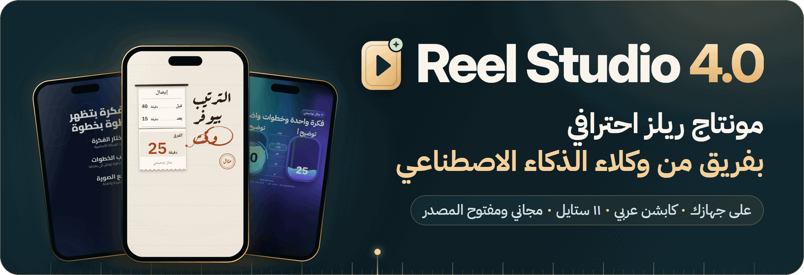
</p>

<h1 align="center">Reel Studio 4.0 🎬</h1>

<p align="center">
  <a href="#start">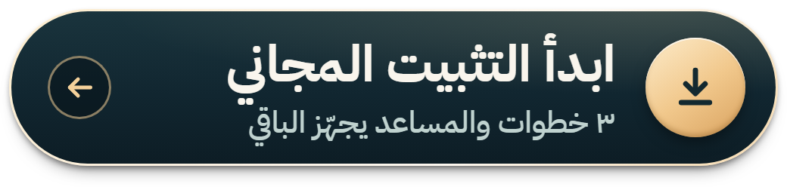</a>
</p>

<p align="center">
  <a href="https://store.pyraai.cloud/product/reel-studio/"></a>
  <a href="https://github.com/mohamedabdou-ai/reel-studio">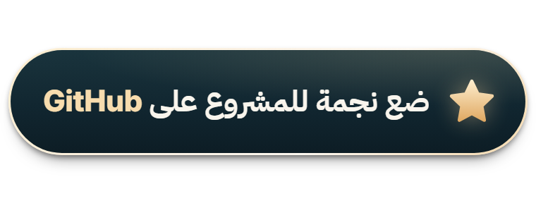</a>
</p>

<p align="center">
  <sub>جلسة خاصة اختيارية ومدفوعة مع صانع الاستوديو عبر الإنترنت: التثبيت، أو حل مشكلة، أو ضبط ريل على ذوقك.</sub>
</p>

<h3 align="center">تابع صانع الاستوديو</h3>

<p align="center">
  <a href="https://www.instagram.com/mohamed.abdou90">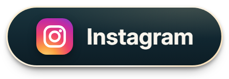</a>
  <a href="https://www.facebook.com/mohamedabdou.ai.90"></a>
  <a href="https://www.tiktok.com/@mohamedabdou.ai">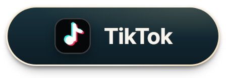</a>
  <a href="https://www.youtube.com/@mohamedabdou-ai"></a>
</p>

<p align="center">
  <a href="#whats-new">الجديد في 4.0</a> ·
  <a href="#capabilities">كل ما يقدر عليه الاستوديو</a> ·
  <a href="#style-copy">انسخ ستايل أي فيديو</a> ·
  <a href="#styles">الـ١١ ستايل</a> ·
  <a href="#podcast-clipping">دفعات البودكاست</a> ·
  <a href="#preferences">ظبّط ذوقك</a> ·
  <a href="#showcase">شوف أمثلة</a> ·
  <a href="#update">حدّث نسختك</a> ·
  <a href="CHANGELOG.md">سجل التحديثات</a>
</p>

**سجّل كلامك أو احكِ فكرتك، ويبني لك فريق مونتاج كامل ريلًا بموشن على مقاسها.** مونتاج رأسي 9:16، وكابشن عربي، وموشن يشرح كل فكرة، ومحرر حي تراجع فيه كل شيء قبل التصدير.

**أعجبك أسلوب فيديو؟ سمِّه فقط:** يتعلّم المساعد إيقاعه وحركته وكابشنه وشكله، ويطبّقها على فيديوك أنت.

كود Reel Studio مجاني بترخيص MIT، ويعمل على Windows 64-bit مع Claude Code أو Codex. استخدام المساعد وتراخيص الأدوات الخارجية منفصلان؛ التفاصيل في [تراخيص الأدوات](NOTICE.md).

<a id="whats-new"></a>

## الجديد في 4.0: الفريق أصبح يرسم كلامك، ولكل ستايل مخرج بطريقته

في 3.0 صار المونتاج فريقًا كاملًا. وفي 4.0 أصبح الفريق يرسم ما تقوله: رقمك يتحول إلى عدّاد أو أعمدة، ومحادثتك إلى فقاعات، وصفحتك أو أداتك إلى شاشة تُبنى من كلامك وتقترب منها الكاميرا عند التفصيلة المهمة. ولكل ستايل من الأحد عشر طريقته في الإخراج: مشاهده وانتقاله وحركته. وكل ذلك من كلامك وأرقامك أنت فقط.

| الجديد | فائدته في عملك |
| --- | --- |
| **الفريق يرسم كلامك** | عدّاد وأرقام تدور وأعمدة وحلقة تمتلئ، ومحادثات وإشعارات، وصفحة ويب أو لوحة أرقام تُبنى من نصوصك، وكل ستايل يرسمها بطريقته. بالأرقام والرسائل التي تقدمها أنت فقط. |
| **ستة ستايلات بتصميم جديد كليًا** | «خطوات منظمة» و«ورق متحرك» و«أدلة وأرقام» و«كولاج» و«زجاج مضيء» و«مجلة» بشكل جديد: عناوين كبيرة تملأ المشهد، ولكل ستايل انتقال خاص به، مثل شريط حبر يكشف الفكرة، وصفحة مجلة تُقلب، وعدسة تقترب من الرقم. ويبقى الكابشن واضحًا فوق أي خلفية. [شوف الستايلات](#styles) |
| **قائمة ستايلات أوضح** | دُمجت خمسة ستايلات في أقرب ستايل لها، فصارت القائمة أحد عشر ستايلًا لكل منها شخصية واضحة. وإذا كان ملفك أو أحد مشاريعك يستخدم ستايلًا منها، ينتقل تلقائيًا. |
| **حركات للعناوين العربية** | إحدى عشرة حركة تحرّك العنوان العربي دون أن ينفصل حرف عن حرف: نقاط تسقط في أماكنها، وقلم يكتب الكلمة، وكشيدة تتمدد، وختم يحجب الكلمة، وكلمة تذوب إلى أخرى، وفيديو داخل الحروف، وغيرها. |
| **كشيدة حية** | تتمدد الكلمة المهمة على وصلات حروفها لحظة نطقها ثم تعود، في الكلمات المتحركة وفي الكابشن، وتتحرك الكلمات المجاورة لتفسح لها المكان دون أن ينكسر السطر. |
| **فحص العربية قبل التسليم** | يتوقف التسليم إذا كان في النص حرف لا يدعمه الخط، أو كلمة تفرّقت حروفها، أو رموز تكسر اتصالها، وينبّهك إلى خلط الاتجاهات والتشكيل المكرر لتقرر بنفسك. |
| **ستايل «وثائقي»** | خريطة ورقية بمسار أحمر بين الأماكن التي تحددها، وتقريب على بلد، وبطاقات صور ممزقة الحواف من صورك، وحبيبات أرشيفية. الخريطة تعرض فلسطين دولة. |
| **ستايل «حوالين المتكلم»** | كلمة كبيرة خلفك، وكلمات حول رأسك، وعلامات مرسومة باليد على الكلمة المهمة. يفصل الاستوديو جسمك عن الخلفية على جهازك. |
| **انتقالات وحركات كاميرا** | أربعة عشر انتقالًا جديدًا، منها صفحة تُقلب في اتجاه الكتاب العربي ونقطة حبر تنتشر ستارةً ومربعات صغيرة تغطي الشاشة ثم تتفكك، وتقريب سريع أو دوران أو اقتراب أو اهتزاز يد للمشهد كله أو لجزء الرسوم في المشهد المقسوم. |
| **مظهر للفيديو كله** | «ريسو» بطباعة حبرين، و«بلوبرنت» بورق أزرق وخطوط بيضاء، و«حبيبات فيلم»، و«ورق» كأن الفيديو مطبوع على ورقة، ويبقى الكابشن واضحًا فوقها كلها. ولمشاهد العناوين ثلاث خلفيات: زخرفة هندسية، وأشعة شمس تدور، وورقة. |
| **خمسة أشكال للكابشن** | مربع ينتقل إلى الكلمة المنطوقة، وكاريوكي، وحدّ عريض، وظل ناعم، وبطاقة ورقية. |
| **ملصقات وخطوط وأصوات** | تسعة وخمسون ملصقًا متحركًا وثابتًا، وسبعة خطوط عربية جديدة منها Lalezar وAref Ruqaa وAmiri، وثمانية وعشرون صوتًا قصيرًا مسجّلًا بترخيص CC0. |

جرّب أن تقول: **«عدّل الفيديو Raw/my-video.mp4 بستايل ورق متحرك، وحرّك العنوان بحركة القلم الذي يكتب الكلمة، واجعل الكلمة المهمة في الكابشن تتمدد بالكشيدة»**.

للتحديث قل **«حدّث الاستوديو»**، ثم افتح جلسة جديدة. بعد التحديث تُنفَّذ خطوات التجهيز مرة واحدة، ومنها تنزيل الخطوط الجديدة ونموذج فصل الشخص عن الخلفية. ملفك الشخصي ومشاريعك محفوظة، وأول مرة تعمل فيها على مشروع قديم يُجهَّز فيديوه من جديد مرة واحدة. [سجل التغييرات](CHANGELOG.md).

<a id="capabilities"></a>

## كل ما يقدر عليه الاستوديو

من الفكرة إلى الريل الجاهز في مكان واحد. اضغط على أي بطاقة لتصل إلى تفاصيلها.

<table>
  <tr>
    <td width="50%"><a href="#style-copy">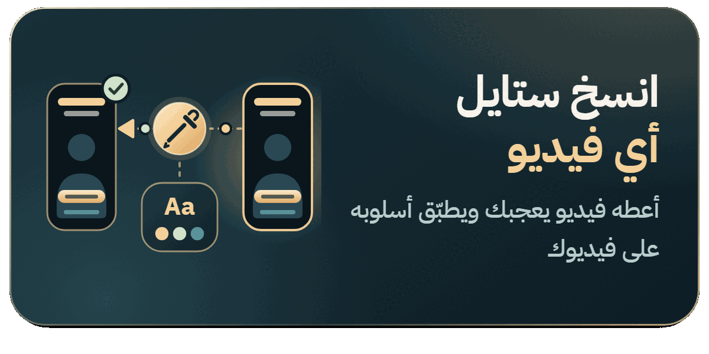</a></td>
    <td width="50%"><a href="#styles">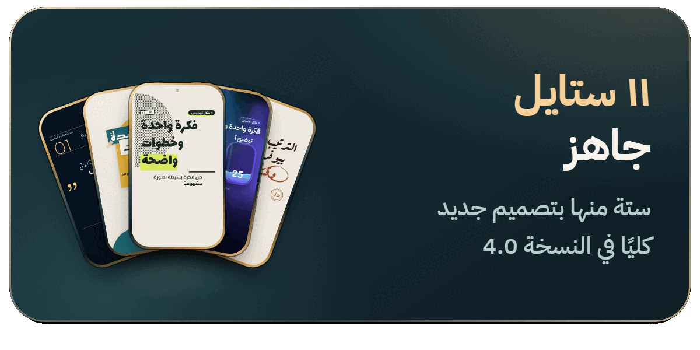</a></td>
  </tr>
  <tr>
    <td width="50%"><a href="#captions">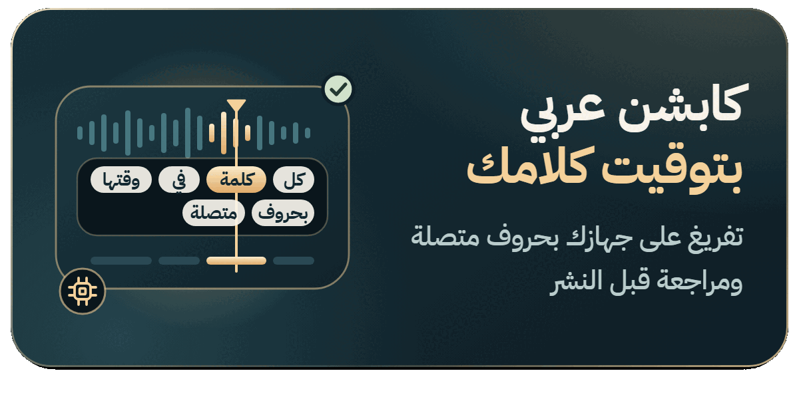</a></td>
    <td width="50%"><a href="#cuts">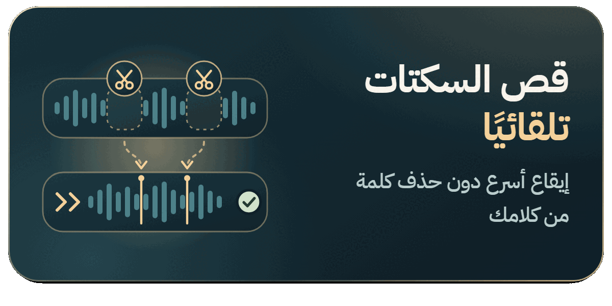</a></td>
  </tr>
  <tr>
    <td width="50%"><a href="#podcast-clipping">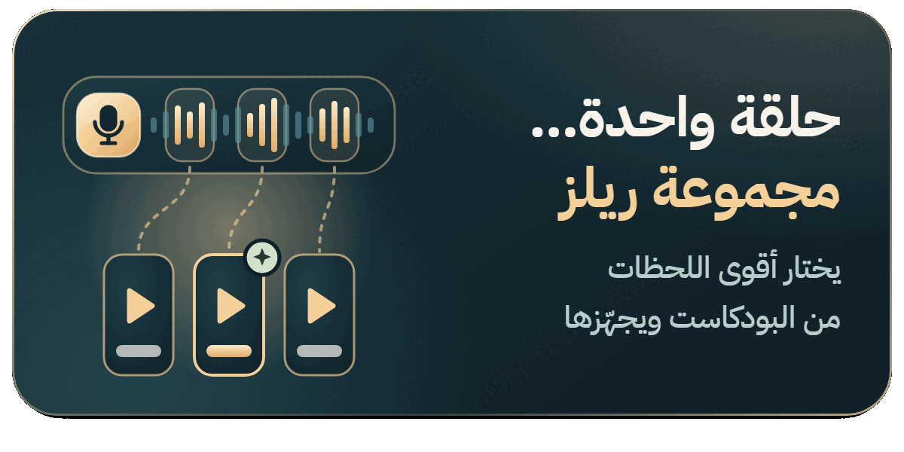</a></td>
    <td width="50%"><a href="#graphics">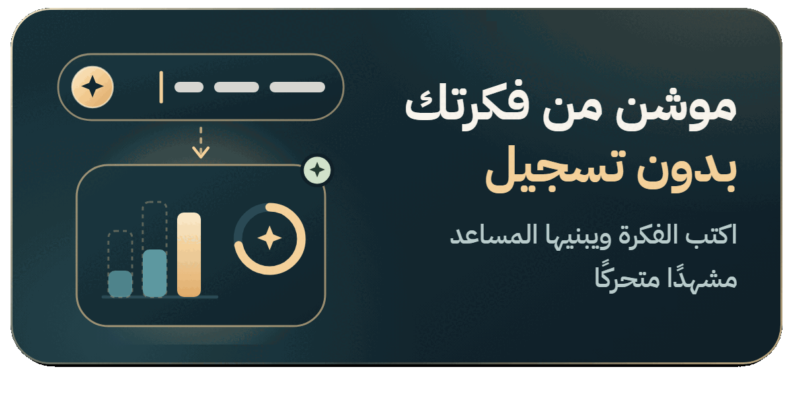</a></td>
  </tr>
  <tr>
    <td width="50%"><a href="#delivery-quality">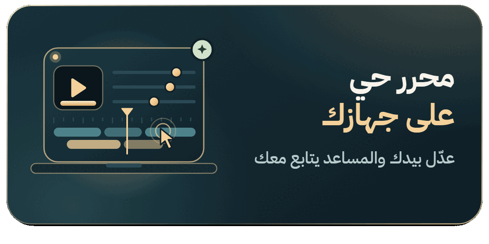</a></td>
    <td width="50%"><a href="#publish">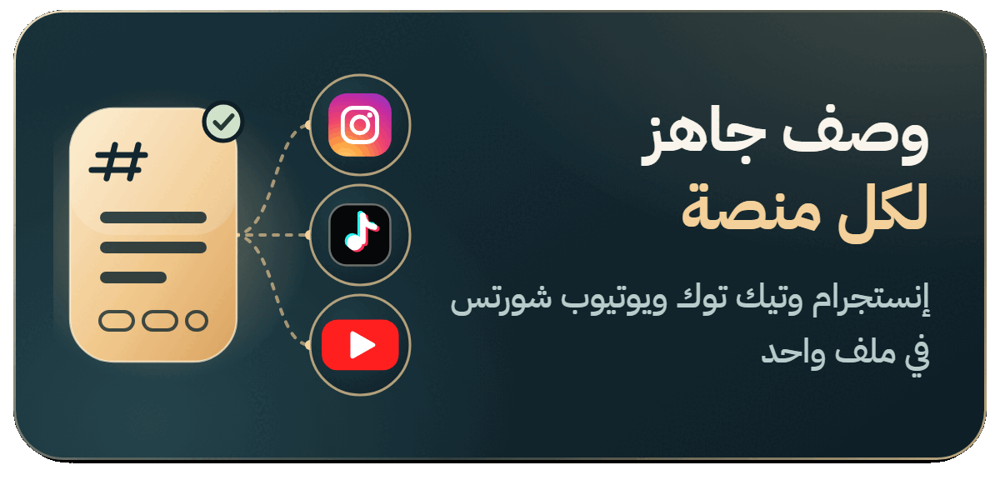</a></td>
  </tr>
</table>

<a id="style-copy"></a>

### انسخ ستايل أي فيديو

أعجبك ريل عند صانع آخر؟ سمِّ الفيديو للمساعد، ملفًا أو رابطًا. يفحص الاستوديو لقطاته إطارًا بإطار، ويقيس إيقاع القطعات، ويقرأ كيف يظهر الكابشن وكيف تتحرك العناصر وكيف يبدو الشكل العام، ثم يحفظ ما تعلّمه في مشروعك كـ«بصمة ستايل» تراجعها وتعدّلها. بعدها يطبّق المساعد الأسلوب نفسه على كلامك أنت، ويعرض عليك مقطعًا قصيرًا فيه أصعب مشهد لتراجعه قبل أن يكمل بقية الفيديو.

يتعلّم من الأسلوب لا من اللقطات؛ فيبقى فيديوك فيديوك، ويبقى الفيديو المرجعي كما هو.

```text
تعلّم أسلوب الفيديو Reference/reference-a.mp4: إيقاعه وحركته والكابشن والشكل.
ثم طبّقه على الفيديو Raw/my-video.mp4، وأرني مقطعًا قصيرًا لأراجعه قبل أن تكمل.
```

[دليل نسخ الستايل للمساعد](instructions/STYLE-LEARNING.md).

### المهارات بالتفصيل

| المهارة | ماذا تقدّم لك |
| --- | --- |
| <a id="team"></a>**فريق مونتاج كامل** | مدير يوزّع العمل على مساعدين متخصصين: يحلل التسجيل ويقترح القص، ويخطط المشاهد، ويجهّز الأصول، ويصمم الصوت، ويبني المونتاج، ويفحص الجودة، ويجهّز التسليم. يراجع المدير كل نتيجة قبل أن تدخل فيديوك، ويبقى وحده من يكتب في مشروعك. [دليل المدير والفريق](instructions/PRODUCTION-MANAGER.md) |
| <a id="captions"></a>**كابشن عربي بذوقك** | تفريغ صوتي يعمل على جهازك وتراجعه كلمة بكلمة، ثم كابشن بتجميع كلمات تختاره (كلمات قصيرة أو جمل أو كلمة في المرة)، وبثلاثة أشكال: كبسولة واضحة أو كلام بلا خلفية أو شريط غامق، ومعها خمسة أشكال أخرى مثل مربع ينتقل إلى الكلمة المنطوقة والكاريوكي. خمسة عشر خيارًا للخط، وأرقام لاتينية أو عربية، وإبراز الكلمات المهمة بلون أو وزن أو نبضة أو كشيدة تتمدد. وإن كان على فيديوك ترجمة مدمجة، يخفي الاستوديو طبقة الكابشن الإضافية ويحتفظ بالكلمات والتوقيت. |
| <a id="cuts"></a>**قص ذكي** | يقص السكتات الطويلة دون حذف كلمة، ويقترح قص التكرار والحشو لتوافق عليه قبل التنفيذ، ولا يقص ختامك المسجّل أبدًا. وفي تسجيلات الشاشة يموّه البيانات الخاصة بعد أن تؤكد أنت المناطق. |
| **تجهيز التسجيل** | يحوّل لقطات iPhone بصيغة HDR والتسجيلات متغيرة المعدل إلى ملف ثابت مناسب للمونتاج، ويبقى تسجيلك الأصلي كما هو. |
| **تسجيل الشاشة** | نقرات تظهر عند موضع المؤشر الحقيقي، وتوضيحات مثبتة على أجزاء الشاشة، وتركيز على لقطة شاشة منفصلة داخل فيديو المتحدث. |
| <a id="motion"></a>**مكتبة حركة تختارها الفكرة** | رسائل متفرقة تجتمع في لوحة واحدة، وطلب واحد يعطي عدة نتائج، ومسار آلي من المحفّز إلى النتيجة، وشرط يحدد المسار، وكروت تتصفّى أمام عينيك، وعدسة تكبّر الرقم المهم، وطبقات نظام تنفتح طبقة طبقة. ومعها مشاهد المقارنة والتذاكر والتعليقات والفصول والاقتباسات والخرائط، وانتقالات وحركات كاميرا. يختار المساعد لكل جزء ما يناسب معناه. [دليل المكتبة](instructions/LIBRARY.md) |
| <a id="sound"></a>**صوت ومؤثرات** | مؤثرات صوتية تُولَّد على جهازك، ولكل ستايل لوحته الصوتية التي توضع على التغييرات الحقيقية في المشهد: بطاقة تظهر، نقرة، عدّاد يدور، ختام. تسمعها في المعاينة وتنقل أو تحذف أي مؤثر وتضبط مستواه من المحرر. ويمكنك تنظيف صوتك داخل المزج النهائي، وضبط الصوت والموسيقى والمؤثرات كلًّا على حدة في نسخة جديدة تحفظ الصورة. [دليل الصوت](instructions/SOUND.md) |
| <a id="graphics"></a>**موشن بلا تسجيل** | اكتب فكرتك ونصها، فيبني الاستوديو فيديو موشن كاملًا بلا تسجيل ولا تعليق صوتي مختلق: شرح مفهوم، أو خريطة، أو عناوين متحركة. وتراجع النص والتوقيت في المحرر قبل التصدير. [دليل الموشن بلا تسجيل](instructions/GRAPHICS.md) |
| **مشهد مصنوع لفكرتك** | حين لا يكفي المشهد الجاهز، يكتب المساعد مشهدًا خاصًا بفكرتك داخل مشروعك، بحقول تعدّلها من المحرر نفسه: النص والتوقيت والألوان والصور. [دليل المشاهد الخاصة](instructions/PROJECT-SCENES.md) |
| **أصول تخدم الشرح** | لقطة شاشة حقيقية تثبت الفكرة، أو رسم يوضحها، أو صورة أو مقطع أو موسيقى يجهزها المساعد بالأدوات المتصلة عندك. ولكل ملف سجل بمصدره وترخيصه. [دليل الأصول](instructions/ASSET-PRODUCTION.md) |
| **أداء المتحدث** | يقترح المساعد إبراز كلمة مهمة بحركة خفيفة حسب ارتفاع صوتك فيها ووجود أرقام وأسماء أدوات، وتراجع الاقتراحات قبل تطبيقها. ونافذة صغيرة لك أثناء مشاهد الشرح الكبيرة في الستايلات التي تدعمها، وخيار إضافي لضبط توقيت الكلمات بعد مراجعة النص. [دليل الأداء](instructions/PERFORMANCE.md) |
| **فحوصات قبل التسليم** | مناطق Instagram Reels الآمنة، وبُعد الرسومات عن وجهك، ومستوى الصوت، وشروط الترميز. وما يفشل في أي فحص يقف عنده التسليم حتى يُصلَح. [التقنيات والفحوصات](instructions/TECHNIQUES.md) |
| **تصدير لا يضيع جهدك** | الفيديو الطويل يُصدَّر على أجزاء محفوظة، فإذا توقف يكمل من حيث وصل. وتستطيع تغيير الصوت وحده بنسخة جديدة تحفظ الصورة، أو إعادة رندر الجزء المتغيّر فقط من الصورة. [دليل الاستكمال والتعديلات](instructions/PRODUCTION.md) |
| **هويتك ونهايتك** | اسمك وحسابك ومنصاتك وألوان علامتك تُحفظ مرة واحدة وتُطبَّق على كل فيديو. وتختار نهاية الفيديو: كلمة للتعليق، أو بطاقة متابعة، أو ختامك المسجّل، أو لا شيء. ويمكنك تغيير أي اختيار لفيديو واحد دون المساس بما حفظته. |

<a id="start"></a>

## ابدأ في ٣ خطوات

تحتاج **Windows 64-bit**، وClaude Code أو Codex يقدر يقرأ ملفاتك ويشغّل الأدوات. تحتاج إنترنت للتجهيز والتحديث واستخدام المساعد، ومساحة للأدوات وفيديوهاتك.

1. افتح فولدر فاضي ومستقل للاستوديو في المساعد.
2. انسخ الجملة دي وابعتها له:

   ```text
   نزّل Reel Studio في الفولدر ده من https://github.com/mohamedabdou-ai/reel-studio واتبع AGENTS.md اللي فيه عشان تجهّزه
   ```

3. اختار اسمك وذوقك من الشاشة العربية، واضغط **«احفظ وابدأ»**. المساعد ينزّل الأدوات جوه الفولدر ويتابع التجهيز وفحص النظام معاك.

<p align="center"><a href="docs/images/readme/shot-onboarding.jpg">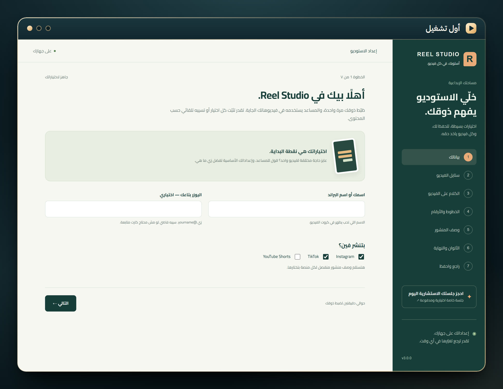</a></p>

<p align="center"><sub>شاشة أول تشغيل. اضغط على الصورة لعرضها بحجمها الأصلي.</sub></p>

بعد التجهيز، حط الفيديو في فولدر `Raw`، وافتح جلسة جديدة في نفس فولدر الاستوديو، وقول:

```text
عدّل الفيديو Raw/my-video.mp4 لريل إنستجرام وتيك توك.
اعرض عليّ التفريغ، واسألني قبل حذف أي كلام، وافتح المحرر لأراجع معك.
```

أول تجهيز بياخد وقت حسب النت والجهاز. لو حاجة وقفت، ابعت للمساعد رسالة الخطأ أو قول **«افحص النظام»**.

<a id="preferences"></a>

## اختار ذوقك مرة… وعدّله وقت ما تحتاج

قول **«افتح إعداداتي»**. تقدر تثبّت كل اختيار، أو تسيبه تلقائي لو الاختيار التلقائي متاح.

<p align="center"><a href="docs/images/readme/shot-settings.jpg">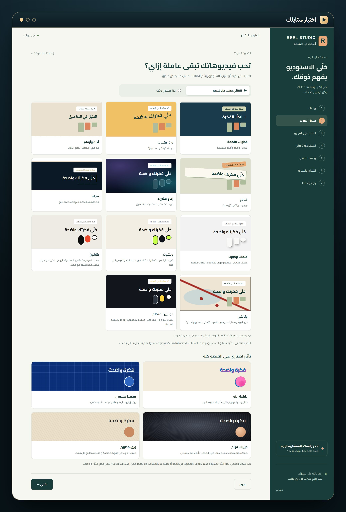</a></p>

<p align="center"><sub>شاشة الإعدادات. اضغط لقراءة التفاصيل بالحجم الأصلي.</sub></p>

| الاختيار | اللي تظبطه |
| --- | --- |
| **الستايل** | واحد من ١١ ستايل، أو يختاره المساعد حسب محتوى كل فيديو. |
| **الكلام على الشاشة** | كلمات قصيرة، جُمل، أو كلمة في المرة؛ مع أشكال مختلفة للكابشن. |
| **الخط** | Cairo، Tajawal، IBM Plex Sans Arabic، Noto Naskh Arabic، Noto Kufi Arabic، Readex Pro، El Messiri، Grid Sans، Lalezar، Aref Ruqaa، Aref Ruqaa Ink، Reem Kufi، Amiri، Alexandria، أو Marhey. |
| **الأرقام** | كما وردت في الكلام، أو أرقام لاتينية 123، أو أرقام عربية ١٢٣. |
| **وصف المنشور** | مختصر، تعليمي، أو حكاية، بلهجة كلامك في الفيديو؛ مستقل عن الكلام اللي بيظهر على الفيديو. |
| **هويتك** | الاسم والهاندل والمنصات وألوان البراند. |
| **النهاية** | كلمة للكومنت، بطاقة متابعة، الختام المسجّل، أو من غيرهم. |

ولفيديو واحد، قول **«الفيديو ده بس خليه زجاج مضيء»**؛ بروفايلك الأساسي يفضل محفوظ.

<a id="styles"></a>

## شوف الـ١١ ستايل

لكل ستايل شكله وحركته وطريقته في شرح الفكرة. هذه لقطات توضيحية من الاستوديو نفسه، وتتغير النصوص والصور والتوقيت حسب محتوى فيديوك. اضغط على أي صورة لعرضها بحجمها الكامل. وإن لم تحدد ستايلًا، يختار المساعد الأنسب لمحتوى فيديوك ويذكر السبب في سطر واحد، واختيارك الصريح أو الثابت له الأولوية.

<table>
  <tr>
    <td align="center" width="33%" valign="top">
      <a href="docs/images/style-section-deck.jpg">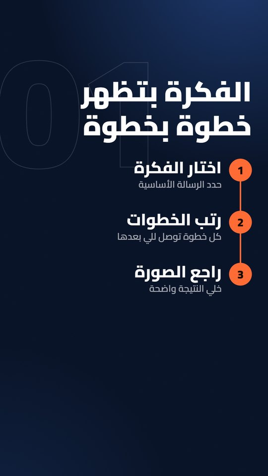</a><br>
      <b>خطوات منظمة</b><br><sub>Section Deck</sub><br>
      عناوين عريضة ورقم قسم كبير، وأفكار مقسمة إلى خطوات وكروت واضحة.<br><sub>تصميم جديد · لقطة ثابتة</sub>
    </td>
    <td align="center" width="33%" valign="top">
      <a href="docs/images/style-kinetic-paper.jpg">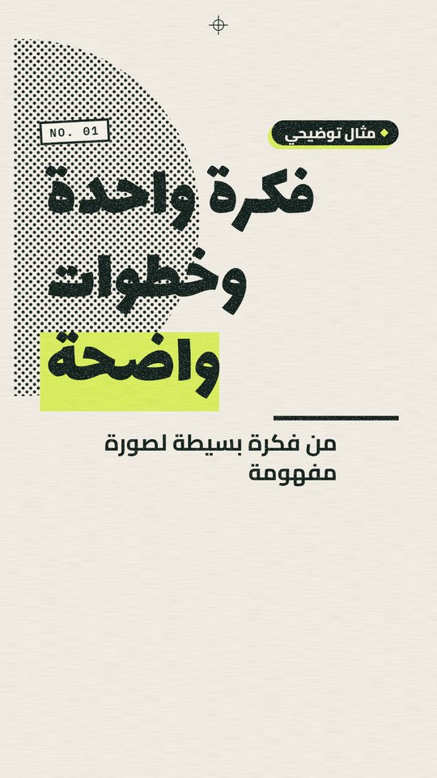</a><br>
      <b>ورق متحرك</b><br><sub>Kinetic Paper</sub><br>
      عناوين ضخمة على الورق، وشرائط حبر تكشف الفكرة، وتذكرة للعروض والدعوات.<br><sub>تصميم جديد · لقطة ثابتة</sub>
    </td>
    <td align="center" width="33%" valign="top">
      <a href="docs/images/style-magazine-interview.jpg">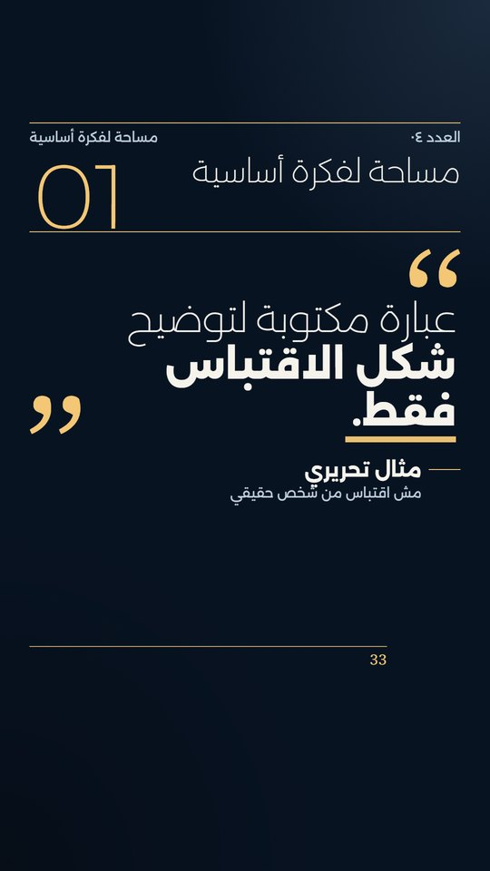</a><br>
      <b>مجلة</b><br><sub>Magazine Interview</sub><br>
      صفحات بفصول مرقمة واقتباسات، وصفحة تُقلب بين المشاهد، وتقييم بالأعمدة لأداة أو فكرة.<br><sub>تصميم جديد · لقطة ثابتة</sub>
    </td>
  </tr>
  <tr>
    <td align="center" width="33%" valign="top">
      <a href="docs/images/style-liquid-glass.jpg">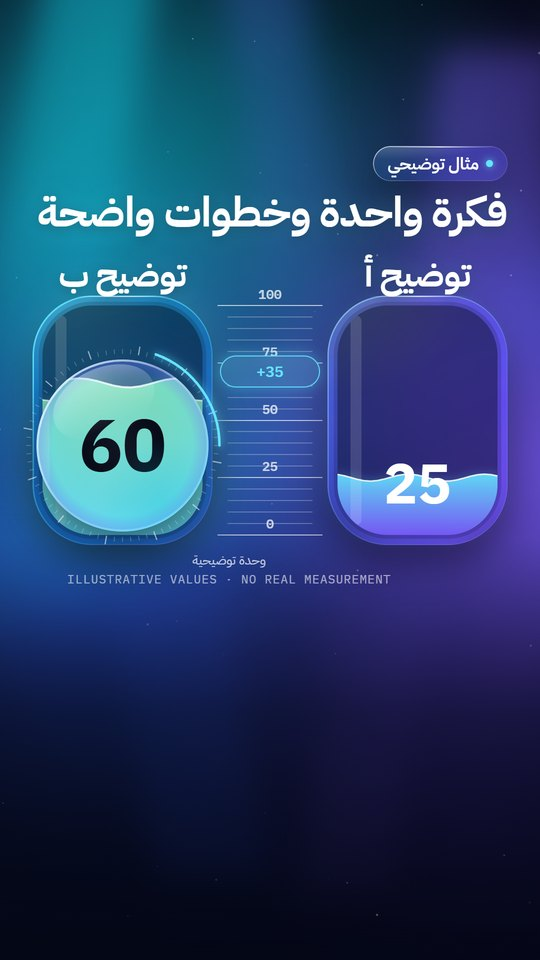</a><br>
      <b>زجاج مضيء</b><br><sub>Liquid Glass</sub><br>
      كروت زجاجية فوق إضاءة ملونة، وعدسة تكبّر التفاصيل، ومقياسان يقارنان بين قيمتين.<br><sub>تصميم جديد · لقطة ثابتة</sub>
    </td>
    <td align="center" width="33%" valign="top">
      <a href="docs/images/style-calligraphic-receipts.jpg">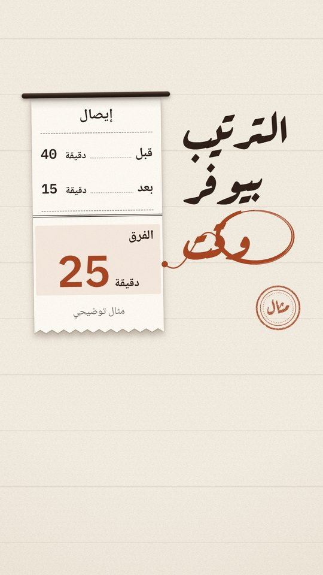</a><br>
      <b>أدلة وأرقام</b><br><sub>Calligraphic Receipts</sub><br>
      عنوان بخط الرقعة بجانب إيصال يعرض الدليل والأرقام سطرًا بسطر.<br><sub>تصميم جديد · لقطة ثابتة</sub>
    </td>
    <td align="center" width="33%" valign="top">
      <a href="docs/images/style-paper-collage.jpg">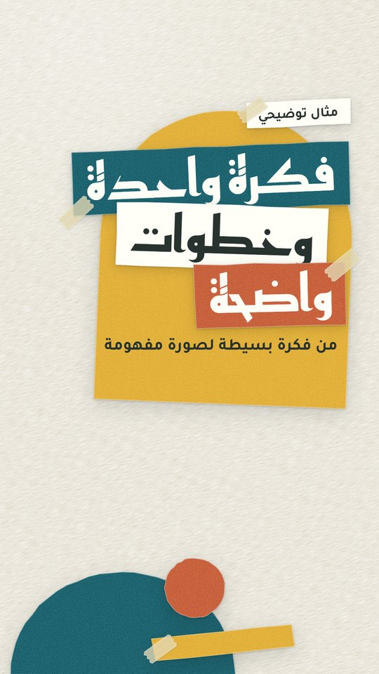</a><br>
      <b>كولاج</b><br><sub>Paper Collage</sub><br>
      قصاصات ورق ملونة وشريط لاصق، ولوحة تجمع الأفكار في مكان واحد.<br><sub>تصميم جديد · لقطة ثابتة</sub>
    </td>
  </tr>
  <tr>
    <td align="center" width="33%" valign="top">
      <a href="docs/images/style-grid-glide.jpg">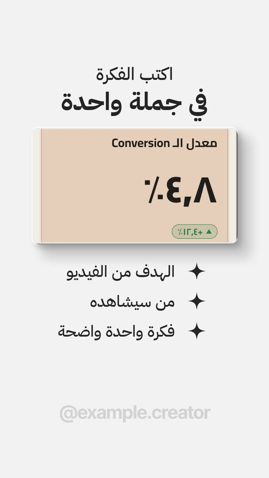</a><br>
      <b>كلمات وكروت</b><br><sub>Grid Glide</sub><br>
      كلمات تنزلق إلى مكانها وكروت ثابتة تعرض لقطات حقيقية.<br><sub>لقطة ثابتة</sub>
    </td>
    <td align="center" width="33%" valign="top">
      <a id="style-one-shot"></a>
      <a href="docs/images/style-one-shot.jpg">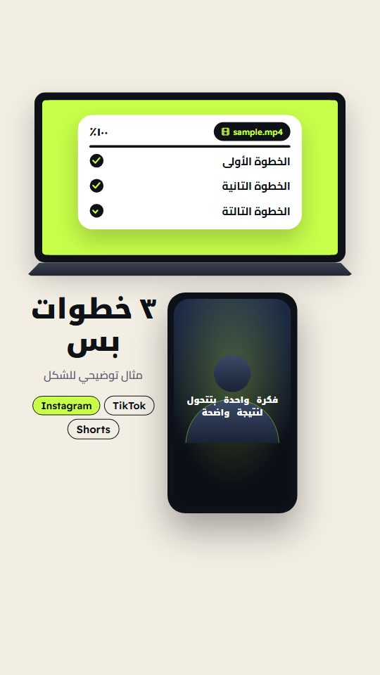</a><br>
      <b>ونشوت</b><br><sub>One Shot</sub><br>
      شرح بلقطة واحدة بلا قطع: كل خطوة تنمو من التي قبلها ثم يعود المشهد إلى بدايته.<br><sub>لقطة ثابتة</sub>
    </td>
    <td align="center" width="33%" valign="top">
      <a id="style-cartoon"></a>
      <a href="docs/images/style-cartoon.jpg">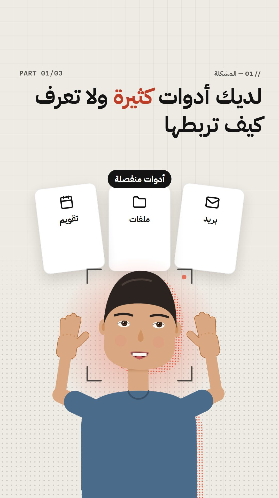</a><br>
      <b>كارتون</b><br><sub>Cartoon</sub><br>
      شخصية مرسومة تشرح بدلًا منك وتشير إلى البطاقات، وعنوان يُكتب كلمة بكلمة مع صوتك.<br><sub>لقطة ثابتة</sub>
    </td>
  </tr>
  <tr>
    <td align="center" width="33%" valign="top">
      <a id="style-documentary"></a>
      <a href="docs/images/style-documentary.jpg">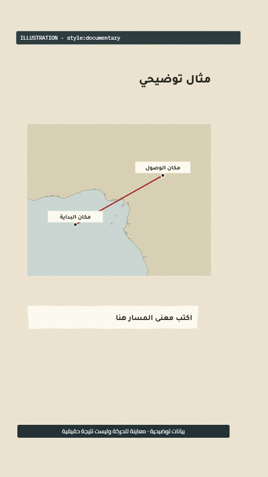</a><br>
      <b>وثائقي</b><br><sub>Documentary</sub><br>
      خريطة بمسار أحمر يتنقل بين المدن، وبطاقات صور ممزقة الحواف، وحبيبات أرشيفية خفيفة.<br><sub>جديد · لقطة ثابتة</sub>
    </td>
    <td align="center" width="33%" valign="top">
      <a id="style-layered-speaker"></a>
      <a href="docs/images/style-layered-speaker.jpg">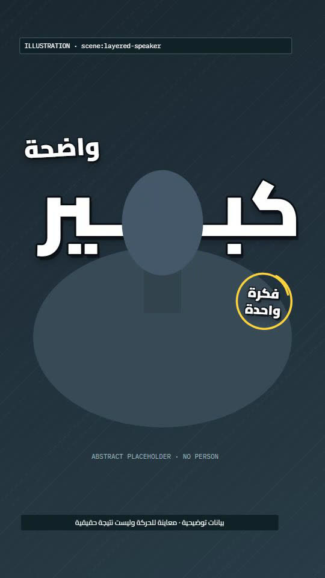</a><br>
      <b>حوالين المتكلم</b><br><sub>Layered Speaker</sub><br>
      كلمة كبيرة خلفك، وكلمات تظهر حول رأسك، ودائرة مرسومة باليد على الفكرة المهمة.<br><sub>جديد · لقطة ثابتة</sub>
    </td>
  </tr>
</table>

هذه هي الأسماء نفسها التي تجدها في شاشة الاختيار. يأخذ «خطوات منظمة» ألوان علامتك، وتحتفظ الستايلات العشرة الأخرى بألوانها.

**إن كنت تستخدم ستايلًا قديمًا:** في 4.0 دُمجت خمسة ستايلات في ستايلات أقرب إليها. «شرح بصري» أصبح ضمن «خطوات منظمة»، و«رحلة على ورق» ضمن «وثائقي»، و«تحريري» و«مقارنة ورأي» ضمن «مجلة»، و«تذاكر وحملات» ضمن «ورق متحرك». إذا كان ملفك الشخصي أو أحد مشاريعك يستخدم اسمًا منها، ينتقل تلقائيًا إلى الستايل الجديد، ولا تحتاج إلى أي إعداد.

<a id="podcast-clipping"></a>

## حلقة واحدة… مجموعة ريلز

عندك بودكاست أو حوار أو شرح طويل؟ المساعد يقترح مقاطع من التفريغ اللي راجعته، وأنت تختار اللي له بداية ونهاية وفكرة مفهومة.

```text
رشّحلي من الفيديو Raw/example-podcast.mp4 مقاطع قصيرة بأفكار مستقلة.
ورّيني المقترحات الأول، وبعد ما أختار جهّز كل مقطع بكابشن ومونتاج يناسبه.
```

- الاختيار والقص بيتراجعوا معاك قبل تجهيز المقاطع.
- كل مقطع له مشروعه ومحرره وتوقيت كلامه، حتى لو بدأ بعد أول عشر دقائق من التسجيل.
- التصدير بيتم بالترتيب، والدفعة تقدر تكمل بعد التوقف باستخدام النتائج السليمة المطابقة.
- لكل فيديو وصف منفصل للمنصات اللي اخترتها، يتراجع مع محتوى المقطع.
- التسجيل الأصلي يفضل محفوظًا؛ كل مقطع ناتج حده الحالي **١٠ دقائق**.

[دليل دفعات البودكاست للمساعد](instructions/PODCAST.md).

<a id="use-cases"></a>

## قول للمساعد عايز تعمل إيه

| عندك إيه؟ | قول له |
| --- | --- |
| **شرح أداة** | «خلّي كل خطوة تظهر وقت ما بشرحها، وورّيني المعاينة.» |
| **مقارنة** | «اعرض الاختيارين جنب بعض مع كل نقطة بقولها.» |
| **رحلة أو مؤتمر** | «رتّب المحطات والصور في رحلة واضحة، وحافظ على ترتيب كلامي.» |
| **مقابلة** | «قسّم الحوار لفصول، وأبرز الاقتباسات واسم المتحدث.» |
| **تسجيل شاشة** | «ركّز على الخطوات، وورّيني البيانات اللي تحتاج تغبيش.» |
| **ستايل فيديو عجبك** | «اتعلّم أسلوب الفيديو Reference/reference-a.mp4 وطبّقه على فيديوي، وورّيني عينة قصيرة الأول.» |
| **فكرة من غير تسجيل** | «اعمل موشن يشرح الفكرة دي من غير تسجيل، وورّيني النص قبل ما تبني المشاهد.» |
| **مش عايز تظهر** | «حوّل الفيديو Raw/my-video.mp4 لستايل كارتون بشخصية مرسومة تشرح بدلي.» |
| **صوت اتعدّل** | «بدّل الصوت بالتسجيل الجديد بنفس المدة والتوقيت، وسيب الصورة زي ما هي، واحفظ نسخة جديدة.» |
| **مشهد محتاج تصحيح** | «صلّح العنوان في المشهد ده، واحتفظ بالأصل والصوت.» |
| **رندر وقف** | «كمّل نفس الرندر، واستخدم الأجزاء السليمة لو الملفات والإعدادات ما اتغيّرش فيها حاجة.» |

تعديل جزء من الصورة بيوفّر إعادة رندر مشاهد المونتاج كلها؛ الصورة الكاملة بتعدّي على ترميز خفيف وفحص قبل حفظ النسخة الجديدة. [دليل التعديلات والاستكمال](instructions/PRODUCTION.md).

<a id="delivery-quality"></a>

## راجع شغلك في محرر حي… ثم استلم ملفك

يفتح المحرر من أول مسودة جاهزة ويبقى مفتوحًا، فترى الكابشن والمشاهد تتغيّر أمامك وأنت تتحدث مع المساعد. يمكنك إيقاف المتابعة وتعديل أي شيء بيدك: نص الكابشن وتوقيته، والمشاهد، والقص، والمؤثرات، وحركات الكاميرا، وخط هذا الفيديو وأرقامه من تبويب «المظهر». كل تعديل يمكن التراجع عنه، وتبقى نسخك السابقة في «السجل» لتعود إليها.

<p align="center"><a href="docs/images/readme/shot-editor.jpg">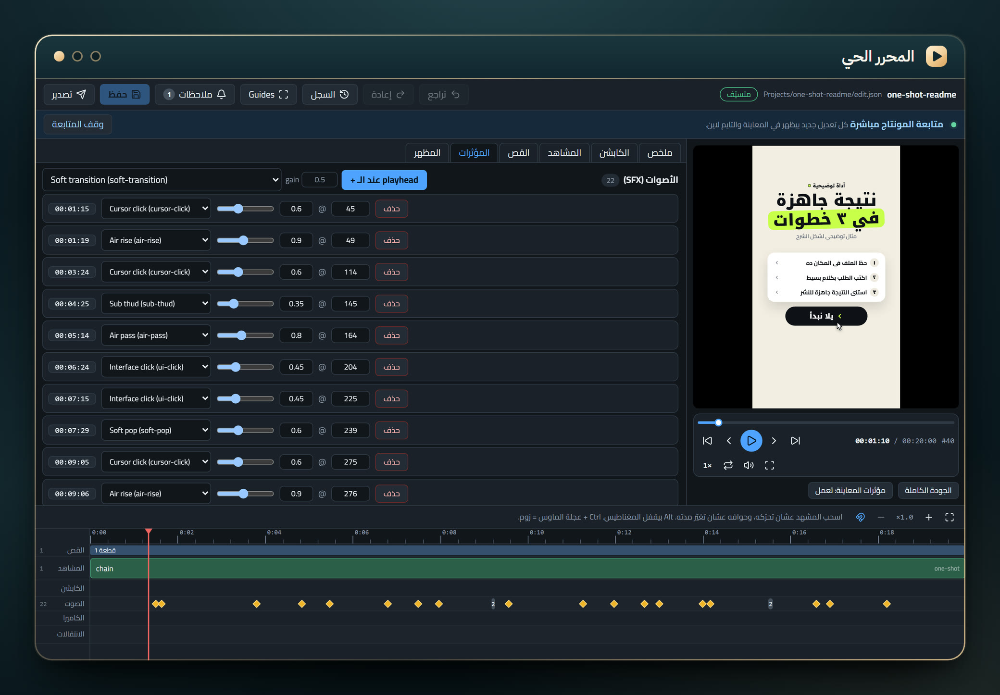</a></p>

<p align="center"><sub>محرر المراجعة. اضغط على الصورة لعرضها بحجمها الأصلي.</sub></p>

قبل التسليم يفحص الاستوديو مناطق **Instagram Reels** الآمنة وموضع الوجه والصوت وشروط التصدير، وتبقى الرسومات بعيدة عن وجهك، وما يفشل في أي فحص يقف عنده التسليم حتى يُصلَح. [التقنيات والفحوصات](instructions/TECHNIQUES.md).

<a id="publish"></a>

### ما الذي تستلمه

تستلم **MP4 رأسيًا في `Outputs`**، ومعه في فيديوهات التسجيل ملف الترجمة **SRT** بتوقيت الفيديو بعد القص وبالكلمات التي راجعتها، وغلاف من لقطة تختارها إن أردت. ويكون وصف المنشور في **`PUBLISH_PACK.md`** داخل مشروع الفيديو في `Projects`: وصف مستقل لإنستجرام وتيك توك، وعنوان ووصف لـYouTube Shorts، بلهجة كلامك في الفيديو، مع النص البديل لإنستجرام والحقوق التي توفرها. يبدأ الوصف بكلمة البحث، ويذكر أسماء الأدوات التي يبحث عنها الناس، ويشوّق لمن لم يشاهد الفيديو دون أن يحرقه.

<a id="showcase"></a>
<a id="examples"></a>
<a id="camera-explainers"></a>
<a id="product-explainers"></a>

## شوف أمثلة من الشغل

**يمين: التصوير الأصلي. شمال: بعد المونتاج.** اضغط على المثال عشان تشوف المقطع.

<table>
  <tr>
    <td align="center" width="50%"><a href="https://store.pyraai.cloud/wp-content/uploads/2026/09/reel-studio-v1-before-after-card.mp4"></a><br><b>أنت داخل بطاقة</b></td>
    <td align="center" width="50%"><a href="https://store.pyraai.cloud/wp-content/uploads/2026/09/reel-studio-v1-before-after-split.mp4"></a><br><b>الفكرة مع المتحدث</b></td>
  </tr>
</table>

الأمثلة دي من أعمال **محمد عبده** بالنظام الكامل اللي اتبنى منه Reel Studio. مشاهدها اتصمّمت لمحتواها؛ الحزمة فيها الأدوات القابلة للاستخدام الموضّحة فوق، والنتيجة بتعتمد على فيديوك واختياراتك ومراجعتك.

<details>
<summary><b>أمثلة أكتر: موشن، مؤتمرات، بودكاست، وشرح عملي</b></summary>

<table>
  <tr>
    <td align="center" width="50%"><br><b>شرح بالموشن</b></td>
    <td align="center" width="50%"><br><b>مؤتمر ورحلة</b></td>
  </tr>
  <tr>
    <td align="center" width="50%"><br><b>مقاطع من بودكاست</b></td>
    <td align="center" width="50%"><br><b>شرح عملي</b></td>
  </tr>
  <tr>
    <td align="center" width="50%"><br><b>خطوات ورحلة عميل</b></td>
    <td align="center" width="50%"><br><b>إعلان مخصّص بالنظام الكامل</b></td>
  </tr>
</table>

<details>
<summary><b>كولاج، كتابة عربية، وأمثلة تانية</b></summary>

<table>
  <tr>
    <td align="center" width="33%"><a href="https://store.pyraai.cloud/wp-content/uploads/2026/09/reel-studio-v1-loop-collage.mp4"></a><br><b>كولاج</b></td>
    <td align="center" width="33%"><a href="https://store.pyraai.cloud/wp-content/uploads/2026/09/reel-studio-v1-loop-calligraphy.mp4"></a><br><b>كتابة عربية</b></td>
    <td align="center" width="33%"><a href="https://store.pyraai.cloud/wp-content/uploads/2026/09/reel-studio-v1-loop-data-story.mp4"></a><br><b>شرح أرقام</b></td>
  </tr>
</table>

<p align="center"></p>

</details>

معاينات GIF المعروضة في الصفحة صامتة. إعلانات 3D والتعليق الصوتي المولّد فيها شغل مخصّص من النظام الكامل؛ الحزمة بتشتغل على تسجيلك، وما بتضيفش توليد صوت أو قالب الإعلانات دي.

[مصادر الأمثلة وحقوقها](docs/media/README.md).

</details>

<a id="update"></a>

## عندك نسخة؟ حدّثها بنفس الطريقة

قول للمساعد **«حدّث الاستوديو»**. وبعد ما يخلص، افتح جلسة جديدة في نفس الفولدر عشان يقرأ التعليمات الجديدة.

ملفات التحديث منفصلة عن بروفايلك وتسجيلاتك ومشاريعك وتصديراتك. لو ملفات النظام نفسها متعدّلة، التحديث يقف ويوضح لك بدل ما يستبدلها.

لو ظهر خطأ، ابعته للمساعد عشان يحدد سببه. احتفظ بالنسخة القديمة لو احتجت تجهيز فولدر جديد؛ حذف مشاريعك مش خطوة مطلوبة للتحديث.

[آخر إصدار](https://github.com/mohamedabdou-ai/reel-studio/releases/latest) · [الجديد في كل نسخة](CHANGELOG.md).

<details>
<summary>الإصدارات السابقة</summary>

<a id="whats-new-3-0"></a>

## الجديد في 3.0: فريق مونتاج يعمل لأجلك، وستايلان جديدان، ومحرر أقوى

| الجديد | فائدته في عملك |
| --- | --- |
| **مدير مونتاج يقود فريقًا** | يوزّع المدير العمل على مساعدين متخصصين في التحليل والتخطيط وتجهيز الأصول والصوت والمونتاج وفحص الجودة والتسليم، ويراجع ما يرجعون به قبل أن يدخل فيديوك. هو وحده من يكتب في مشروعك ويتحدث معك. |
| **ستايل «ونشوت»** | شرح بلقطة واحدة بلا قطع: كل خطوة تنمو من التي قبلها ثم يعود المشهد إلى بدايته، فيتكرر الفيديو بسلاسة. مناسب لشرح أداة من فتحها حتى النتيجة. |
| **ستايل «كارتون»** | شخصية مرسومة تشرح بدلًا منك، تشير إلى البطاقات وتتحرك مع صوتك، والعنوان يُكتب كلمة بكلمة. تختار شكلها من إعدادات جاهزة، ولا تحتاج أن تظهر في الفيديو. |
| **حركة تختارها الفكرة** | يختار المساعد حركة كل جزء حسب معناه من مكتبة لكل عنصر فيها شرح لمتى يناسب وحدوده، ومعها فكرتان جديدتان: طلب واحد يختار مساره حسب شرط، وكروت تتصفّى حسب معايير. |
| **ستايل يُختار بفهم** | يختار المساعد الستايل المناسب لفكرة الفيديو ويذكر السبب في سطر واحد، واختيارك الصريح أو الثابت له الأولوية. |
| **سكتات تناسب نوع الفيديو** | في الشروحات والنصائح تُختصر السكتات الطويلة تلقائيًا دون حذف أي كلمة، وفي الحكايات والآراء والنكات تبقى السكتات المقصودة ويسألك المساعد عنها مرة واحدة. |
| **تبويب «المظهر» في المحرر** | غيّر خط الفيديو وتجميع كلمات الكابشن وشكله وشكل الأرقام، وشاهد النتيجة فورًا دون المساس بإعداداتك المحفوظة. |
| **مؤثرات تسمعها في المعاينة** | تسمع كل مؤثر صوتي في مكانه وبمستواه أثناء المعاينة، مع زر لإيقافها، ويبقى التصدير النهائي كما هو. |
| **مشاهد جاهزة في المحرر** | أضف من «مشهد جديد» النقاط أو الرقم أو العدّاد أو النتيجة أو الجملة الكبيرة أو دعوة التعليق والمتابعة، أو أي فكرة من أفكار الحركة. ولا يخرج الفيديو النهائي وفيه رقم أو نص تجريبي. |
| **شكل الأرقام باختيارك** | أرقام لاتينية 123 أو عربية ١٢٣ على الشاشة وفي الكابشن، وإن لم تختر يبقى كل رقم كما ورد. |
| **عناوين عربية وثلاثة خطوط جديدة** | تظهر العناوين الثابتة في بطاقات التعليق والمتابعة وغيرها بالعربية حين يكون نص البطاقة عربيًا، وأُضيفت خطوط Noto Kufi Arabic وReadex Pro وEl Messiri. |
| **ملف ترجمة SRT بجانب الفيديو** | عند تسليم فيديو مسجَّل يوضع بجانب الفيديو النهائي ملف ترجمة SRT بتوقيت الفيديو بعد القص وبالكلمات التي راجعتها. |
| **تعديلاتك في أمان** | لا يعيد المساعد بناء الفيديو فوق تعديلاتك في المحرر دون علمك، ويحتفظ بالنسخ السابقة في «السجل»، وأوامر التصدير والفحص لا تكتب خارج مجلد المشروع ولا تلمس تسجيلاتك الأصلية. |
| **أسئلة أقل أثناء العمل** | في Claude Code تعمل أوامر الاستوديو اليومية دون سؤال بعد أن تثق في المجلد مرة واحدة. |
| **تحديثات رسمية فقط** | يصل التحديث من الإصدارات المنشورة فقط، ولا يصل إليك عمل قيد التجربة. |

جرّب أن تقول: **«عدّل الفيديو Raw/my-video.mp4، واختر الستايل المناسب واشرح لي السبب»**.

للتحديث قل **«حدّث الاستوديو»**، ثم افتح جلسة جديدة. بعد التحديث تُنفَّذ خطوات التجهيز مرة واحدة، ومنها تنزيل الخطوط الجديدة. ملفك الشخصي ومشاريعك محفوظة. [سجل التغييرات](CHANGELOG.md).

<a id="whats-new-2-5"></a>

## الجديد في 2.5: كلمات وكروت وتجهيز أسهل

| الجديد | فائدته في عملك |
| --- | --- |
| **ستايل «كلمات وكروت»** | كلمات تنزلق إلى مكانها داخل تصميم مكتمل، وكروت ثابتة تعرض لقطات حقيقية من الأداة أو الشاشة التي تشرحها؛ مناسب لشروحات مثل «خمس أدوات» أو «ثلاث خطوات». |
| **مشاهد وخاتمة مخصصة له** | فصل برقم ترتيبي وشارة للأداة، وكرت بنقاط وسطر مميز، وأسطر للمقدمة والخلاصة، ثم خاتمة للتعليق وأخرى للمتابعة بنفس لغة الستايل. تُعدَّل كلها من المحرر. |
| **صوت هادئ ومحدود** | نبضات منخفضة عند القطعات والشارات فقط، دون مؤثرات على الكلمات؛ تُولَّد محليًا ولا تحتاج إلى ملفات صوت. |
| **خط للعربية واللاتينية معًا** | الأسماء والأرقام اللاتينية بخط Inter، والعربية بخط IBM Plex Sans Arabic، في خيار خط واحد اسمه Grid Sans. |
| **ستايلات أنظف وتطوير أسرع** | لكل ستايل مجلد ودليل مستقل، فتصل الستايلات القادمة أسرع وبأمان أكبر. شكل الستايلات الأحد عشر السابقة لم يتغير. |
| **تجهيز كامل من أول مرة** | يُنزِّل التثبيت الأول أداة التفريغ الصوتي (نحو ١.٥ جيجابايت) مع باقي الأدوات، فيعمل أول فيديو مباشرة دون انتظار تنزيل إضافي. |
| **مستوى صوت صحيح للفيديوهات الهادئة** | إذا كان الفيديو بلا صوت بشري ومؤثراته خافتة، يطبق الاستوديو تصحيحًا واحدًا محدودًا حتى يقترب من مستوى الصوت المطلوب في المنصات، ولا يتغير أي فيديو كان مطابقًا من قبل. |
| **اقتراح للتنويع** | يدخل هذا الستايل ضمن اقتراحات المساعد التلقائية، وتتراجع الستايلات التي استخدمتها مؤخرًا لصالح التنويع، والقرار لك دائمًا. |

جرّب أن تقول: **«اصنع شرحًا من ثلاث خطوات بستايل كلمات وكروت، وجهّز لقطة شاشة لكل خطوة»**.

للتحديث قل **«حدّث الاستوديو»**، ثم افتح جلسة جديدة. بعد التحديث تُنفَّذ خطوات التجهيز مرة واحدة، ومنها تنزيل الخط الجديد Inter وأداة التفريغ الصوتي إن لم تكن لديك. ملفك الشخصي ومشاريعك محفوظة. [سجل التغييرات](CHANGELOG.md).

<a id="whats-new-2-3"></a>

## الجديد في 2.3: موشن على مقاس فكرتك

| الجديد | فايدته في شغلك |
| --- | --- |
| **مشهد مخصوص للفكرة** | المساعد يقدر يبني رسم أو حكاية بصرية جديدة، وتعدّل كلامها وتوقيتها في نفس المحرر. |
| **ستايل له طريقة إخراج** | يراجع الريفرنس اللي اخترته، ويستخلص منه الإيقاع وتكوين المشهد والحركة، ويطبّقهم على محتواك. |
| **أصول تخدم الشرح** | يختار الصورة أو اللقطة أو الرسم المناسب للفكرة، ويجهّزه ويراجعه معاك. |
| **حركة على الكلمة المهمة** | اقتراحات لحركات تأكيد بسيطة حسب كلامك وأدائك، مع مراجعتك قبل تطبيقها. |
| **الشرح كبير وأنت ظاهر** | خلي مشهد الشرح ياخد مساحته، وصورتك تظهر في نافذة صغيرة مناسبة. |
| **تسليم أوسع للنشر** | وصف لإنستجرام وتيك توك، وعنوان ووصف لـYouTube Shorts حسب منصاتك، مع النص البديل والحقوق اللي وفّرتها. |

جرّب تقول: **«اعمل مشهد يوضح إزاي الأفكار المتفرقة تتحول لخطة واضحة، وخلي نفس العناصر تتحرك وتوصل النتيجة»**.

للتحديث قول **«حدّث الاستوديو»**، وبعده افتح جلسة جديدة. بروفايلك ومشاريعك محفوظين.

<a id="whats-new-2-2"></a>

## الجديد في 2.2: الفكرة تتحرك وتتوضح قدامك

| الجديد | فايدته في شغلك |
| --- | --- |
| **موشن من غير تصوير** | اشرح فكرتك برسوم متحركة، حتى لو معندكش تسجيل أو تعليق صوتي. المساعد يجهّزها في نفس المحرر. |
| **حركة توضح العلاقة** | نفس الرسائل تتجمع في لوحة، وبعدها النتيجة المهمة تكبر قدام المشاهد؛ الحركة بتحافظ على معنى العناصر. |
| **أفكار موشن قابلة للتعديل** | تحويلات، خطوات، عدسات وتركيز، مع كتابة متحركة ومقارنة بالصور اللي اخترتها. تراجع الكلام والتوقيت من المحرر. |
| **اختيار أوسع لذوقك** | الترشيح يقارن الـ١١ ستايل، واختيارك لفيديو واحد أو اختيارك الثابت يفضل له الأولوية. |
| **كابشن جاهز من غير تكرار** | لو الفيديو عليه ترجمة بالفعل، المساعد يقدر يخفي الطبقة الإضافية ويحافظ على النص والتوقيت للمراجعة والقص. |
| **راجع شغلك من البداية** | افتح المحرر بعد التجهيز، وشوف المشاهد وعدّلها قبل التصدير. |

جرّب تقول: **«اعمل موشن يوضح إزاي الرسائل المتفرقة تتجمع في لوحة واحدة، وورّيني الفكرة قبل التصدير»**.

عندك نسخة؟ قول **«حدّث الاستوديو»**، وبعد التحديث افتح جلسة جديدة. بروفايلك ومشاريعك يفضلوا محفوظين. [سجل التغييرات](CHANGELOG.md).

<a id="whats-new-2-1"></a>

## الجديد في 2.1: وصف منشور بيشوّق من غير ما يحرق الفيديو

| الجديد | فايدته في شغلك |
| --- | --- |
| **وصف بيساعد على انتشار فكرتك** | كلمة البحث في أول سطر، وأسماء الأدوات اللي الناس بتدوّر عليها، وتشويقة للي ما شافش الفيديو، من غير ما الوصف يحرق الفيديو. |
| **بلهجتك** | الوصف بيتكتب باللهجة اللي بتتكلّم بيها في الفيديو: خليجي، مصري، شامي أو غيرهم. ولو اللهجة مش واضحة، المساعد بيسألك مرة واحدة. |
| **فحص قبل التسليم** | قبل ما يتعمل `PUBLISH_PACK.md` الوصف بيتفحص: لو نقل جُمل من كلامك، أو كرّر نفس النص على إنستجرام وتيك توك، أو استخدم هاشتاجات حشو زي #fyp، المساعد بيكتبه من جديد. |

عندك نسخة؟ قول **«حدّث الاستوديو»**. [تفاصيل إصدار 2.1.0](https://github.com/mohamedabdou-ai/reel-studio/releases/tag/v2.1.0) · [سجل التغييرات](CHANGELOG.md).

<a id="whats-new-2-0"></a>
<a id="motion-explainers"></a>

## إيه الجديد في 2.0؟

| الجديد | فايدته في شغلك |
| --- | --- |
| **٤ ستايلات جديدة** | زجاج مضيء للشرح، تذاكر وحملات للعروض، حوار مجلة للمقابلات، ورحلة على ورق للمحطات والمؤتمرات. |
| **٦ مشاهد تشرح المعنى** | عدسة، مقارنة بمقياس واحد، تذكرة، أسئلة وتعليقات، فصل واقتباس، وخريطة بمحطات وصور. |
| **استكمال الرندر** | لو التصدير وقف، كرّر نفس الطلب؛ الأجزاء السليمة تتستخدم تاني لما الملفات والإعدادات ما تتغيّرش. |
| **تعديل الصوت لوحده** | بدّل التسجيل أو ظبّط المزيكا والمؤثرات في نسخة جديدة تحافظ على الصورة؛ مدة الصوت وتوقيته لازم يتوافقوا مع الفيديو. |
| **تعديل جزء من الصورة** | المساعد يعيد رندر الفريمات المتغيّرة، ويجهّز النسخة الكاملة مع الاحتفاظ بصوت الأصل. |
| **دفعات بودكاست منظمة** | مقترحات تراجعها، مقاطع تختارها، وتجهيز وتصدير بالترتيب مع استكمال الدفعة بعد التوقف. |

الستايلات السابقة وإعداداتك موجودة. [تفاصيل إصدار 2.0.0](https://github.com/mohamedabdou-ai/reel-studio/releases/tag/v2.0.0) · [سجل التغييرات](CHANGELOG.md).

</details>

## أسئلة سريعة

<details>
<summary><b>ينفع على الموبايل أو Mac؟</b></summary>

التجهيز الحالي مخصص لـWindows 64-bit. الموبايل وmacOS مش مدعومين حاليًا.

</details>

<details>
<summary><b>الفيديوهات بتترفع؟ وبينشر بدلّي؟</b></summary>

التفريغ والرندر والفحوصات بتتم على جهازك. Reel Studio نفسه ما بيرفعش فيديوهاتك ولا بينشرها؛ استخدام المساعد بيخضع لإعدادات وخصوصية الخدمة اللي تختارها. بتراجع الملف ووصف المنشور وتنشر بنفسك.

لمعرفة أن التحديثات تصل وتعمل، يرسل الاستوديو إشارة صغيرة عند نجاح التثبيت، وإشارة عند استخدامه مرة واحدة في اليوم على الأكثر. ويرسل أيضًا إشارة عند تسليم فيديو نهائي تحمل اسم الستايل فقط، وإشارة إذا توقف التثبيت تحمل اسم الخطوة التي توقف عندها فقط. تحمل كل إشارة رقم الإصدار ومعه رمز عشوائي خاص بهذا التثبيت لا يدل عليك. لا تُرسل أسماء أو فيديوهات أو ملفات من جهازك. لإيقاف هذه الإشارات تمامًا، اطلب من المساعد ضبط متغير البيئة `REEL_STUDIO_STATS` على `off`.

</details>

<details>
<summary><b>أحتاج برنامج مونتاج أو أكتب أوامر؟</b></summary>

المساعد بيجهّز الأدوات ويشغّلها. أنت تختار وتراجع وتتكلّم معاه بالكلام العادي، وتقدر تعدّل من محرر المراجعة.

</details>

<details>
<summary><b>تحتاج مساعدة مباشرة، أو تريد دعم المشروع؟</b></summary>

احجز جلسة خاصة عبر الإنترنت مع صانع الاستوديو. تشارك شاشتك ونعمل معًا على جهازك: التثبيت، أو حل خطأ، أو ضبط ريل حتى يخرج كما تريد. الأداة مجانية، والجلسة اختيارية تُدفع مرة واحدة، ومقابلها يدعم تطوير Reel Studio.

[احجز جلستك الاستشارية اليوم](https://store.pyraai.cloud/product/reel-studio/)

</details>

<details>
<summary><b>التجهيز وقف أو عايز تبلغ عن مشكلة؟</b></summary>

ابعت للمساعد رسالة الخطأ. ولو هتفتح [Issue](https://github.com/mohamedabdou-ai/reel-studio/issues/new)، اكتب الإصدار والخطوة اللي وقفت ورسالة الخطأ، واحذف أي بيانات شخصية من الصور والسجلات.

وإذا أردت أن نحلها معك مباشرة على جهازك في جلسة خاصة اختيارية ومدفوعة: [احجز جلستك الاستشارية اليوم](https://store.pyraai.cloud/product/reel-studio/).

</details>

## أدلة للمساعد والمساهمين

| الدليل | هتلاقي فيه إيه؟ |
| --- | --- |
| [AGENTS.md](AGENTS.md) | نقطة البداية والتثبيت وطريقة التعامل مع صاحب الفيديو. |
| [التجهيز والتحديث](instructions/SETUP.md) | التثبيت وفحص النظام والتحديث. |
| [رحلة المونتاج](instructions/EDITING.md) | من مراجعة التسجيل لحد التسليم ووصف المنشور. |
| [مدير المونتاج والفريق](instructions/PRODUCTION-MANAGER.md) | كيف يوزّع المدير العمل على المساعدين ويراجع نتائجهم ويدمجها في فيديوك. |
| [نسخ ستايل فيديو](instructions/STYLE-LEARNING.md) | كيف يتعلّم المساعد أسلوب فيديو مرجعي ويطبّقه على فيديوك. |
| [الستايلات](instructions/STYLES.md) | جدول الستايلات ودليل مستقل لكل ستايل: الشكل والوصفة والمشاهد الخاصة. ولإضافة ستايل جديد: [قائمة التحقق](instructions/STYLE-AUTHORING.md). |
| [موشن بلا تسجيل](instructions/GRAPHICS.md) | بناء فيديو موشن من نص تكتبه دون تسجيل. |
| [مكتبة الحركة](instructions/LIBRARY.md) | اختيار الحركة المناسبة لمعنى كل جزء. |
| [المشاهد الخاصة بفكرتك](instructions/PROJECT-SCENES.md) | مشهد يُكتب خصيصًا لفكرتك ويُعدَّل من المحرر. |
| [الصوت والمؤثرات](instructions/SOUND.md) | أي مؤثر يُستخدم ومتى وبأي مستوى. |
| [أصول الشرح](instructions/ASSET-PRODUCTION.md) | تجهيز الصور واللقطات والرسوم والصوت مع سجل مصادرها. |
| [أداء المتحدث](instructions/PERFORMANCE.md) | إبراز الكلمات المهمة ونافذة المتحدث وضبط توقيت الكلمات. |
| [دفعات البودكاست](instructions/PODCAST.md) | اختيار المقاطع وتجهيزها وتصديرها بالترتيب. |
| [الاستكمال والتعديلات](instructions/PRODUCTION.md) | رندر على أجزاء، تعديل الصوت، وتصحيح جزء من الصورة. |
| [محرر المراجعة](instructions/REVIEW-EDITOR.md) | المعاينة والتعديل اليدوي والحفظ. |
| [التقنيات والفحوصات](instructions/TECHNIQUES.md) | القدرات اللي في الحزمة وحدودها. |
| [دليل المساهمة](CONTRIBUTING.md) | تنظيم الملفات وفحوصات التعديل والنشر. |
| [سجل التحديثات](CHANGELOG.md) | الجديد في كل إصدار. |

---

<h2 align="center">صنعه محمد عبده</h2>

<p align="center">
  <a href="https://store.pyraai.cloud/product/reel-studio/"></a>
  <a href="https://github.com/mohamedabdou-ai/reel-studio"></a>
</p>

<p align="center">
  <a href="https://www.instagram.com/mohamed.abdou90"></a>
  <a href="https://www.facebook.com/mohamedabdou.ai.90"></a>
  <a href="https://www.tiktok.com/@mohamedabdou.ai"></a>
  <a href="https://www.youtube.com/@mohamedabdou-ai"></a>
</p>

[احجز جلستك الاستشارية اليوم](https://store.pyraai.cloud/product/reel-studio/) · [رخصة MIT](LICENSE) · [تراخيص الأدوات الخارجية](NOTICE.md)

</div>
